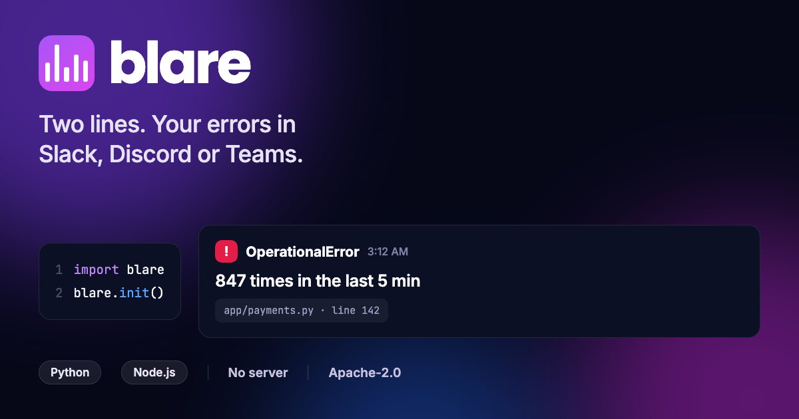

<div align="center">



# blare

### Send production errors to Slack, Discord and Teams — in two lines

Error alerting for **Python** and **Node.js** that needs no server, no database
and no dashboard. One message per problem, not one per crash.

[](https://pypi.org/project/blare/)
[](https://pypi.org/project/blare/)
[](https://www.npmjs.com/package/@geekvb/blare)
[](https://www.npmjs.com/package/@geekvb/blare)

[](https://github.com/D4RKGEEK/blare/actions/workflows/ci.yml)
[](SPEC.md)
[](LICENSE)
[](https://pypi.org/project/blare/)


**[Live demo](https://d4rkgeek.github.io/blare/)** ·
[Quickstart](#quickstart) ·
[What it captures](#what-it-captures) ·
[Why it won't spam you](#why-it-wont-spam-you) ·
[Specification](SPEC.md) ·
[FAQ](#faq)

</div>

---

## Quickstart

### Python

```bash
pip install blare
```

```python
import blare
blare.init()
```

### Node.js / TypeScript

```bash
npm install @geekvb/blare
```

```js
import blare from "@geekvb/blare";
blare.init();
```

### Then one environment variable

```bash
BLARE_SINKS=https://hooks.slack.com/services/T000/B000/xxxx
BLARE_ENV=production
```

Paste the webhook URL your chat tool gave you — Slack, Discord and Teams are
detected from the hostname, so there is no URL scheme to learn. Several URLs,
comma separated, all get a copy.

Confirm it works **before** you need it:

```bash
python -m blare --send          # Python
npx @geekvb/blare --send        # Node
```

<div align="center">

> 🟠 **OperationalError: connection pool exhausted**
> `checkout-api · production` — **847 times in the last 5 min**
> `app/payments.py:142 in charge`

**One message. Not 847.**

</div>

## Why this exists

Most teams write this twice: a logging handler that posts to a Slack webhook,
and then, a week later, the throttling that stops it drowning the channel. The
first half is a weekend. The second half is the part everybody skips, and it is
why that channel is muted today.

The tools that exist each solve one half:

| | What it does | What's missing |
| --- | --- | --- |
| **Apprise**, **Shoutrrr** | Deliver a message to 100+ services | They don't capture anything — you write the glue |
| **Sentry**, **GlitchTip**, **Bugsink** | Capture errors properly | You run a server, a database and a dashboard |
| `express-error-slack` and friends | The glue, for one framework and one channel | One language, no grouping, mostly unmaintained |

blare is the missing middle: **capture + grouping + delivery, as a library.**

It is **not** an error tracker and does not try to be. There is no history, no
search and no UI. If you want those, run Sentry or Bugsink and let blare stay
out of it — they solve different problems and work fine together.

## What it captures

Everything in the first two rows needs **no code changes at all**:

| | Python | Node.js |
| --- | --- | --- |
| **Existing log calls** | `logging` handler on the root logger | pino stream · winston transport |
| **Unhandled crashes** | `sys.excepthook`, thread hook | `uncaughtException`, `unhandledRejection` |
| **Web frameworks** | FastAPI · Starlette · Litestar · Quart · Flask · Django | Express · Fastify · NestJS · Next.js (server) |
| **Background jobs** | Celery | — |
| **Anything else** | any WSGI app | — |

Frameworks take one line:

```python
app.add_middleware(BlareASGIMiddleware)        # FastAPI
install(app)                                   # Flask
```

```js
app.use(blareErrorHandler());                  // Express
app.register(blarePlugin);                     // Fastify
```

## Where it sends

| Destination | Format | Status |
| --- | --- | --- |
| **Slack** | Block Kit | ✅ |
| **Discord** | embeds | ✅ |
| **Microsoft Teams** | Adaptive Card *and* legacy MessageCard, chosen by URL | ✅ |
| **Any webhook** | the canonical event as JSON | ✅ |
| Console | stderr, for local development | ✅ |

The generic sink posts [the canonical event](SPEC.md#7-the-canonical-event)
unchanged, so PagerDuty, n8n, a Lambda or your own relay all work today
without blare knowing about them.

## Why it won't spam you

This is the part that matters, and the reason blare is not a fifty-line snippet.

**1. Identical failures are grouped.** Each failure is reduced to a fingerprint
built from its type, the line in *your* code that caused it, and the message
with its variable parts stripped out. `User 4821 not found` and
`User 9173 not found` are one problem.

**2. One alert per problem per window.** Default five minutes. The suppressed
occurrences aren't lost — they ride along as a count on the next alert, so
there's no background timer and no second "summary" message.

**3. A hard ceiling.** At most 20 alerts an hour, whatever happens. The number
dropped by the ceiling is reported on the next alert that gets through, so the
limit can't hide a cascade from you.

**4. Blame the right line.** The frame chosen is the innermost one that *isn't*
in `site-packages` or `node_modules` — the line in your code, not the line
inside the database driver where it surfaced.

**5. It works across workers.** Dedupe state lives in a lock-guarded file
shared by every process on the host, so four Gunicorn workers seeing one crash
send one alert.

## Language support

blare is specified first and implemented per language. [`SPEC.md`](SPEC.md)
defines fingerprinting, throttling, redaction and the payload exactly, and
[`conformance/`](conformance/) holds the shared fixtures **every** port must
pass — so a Node service and a Python service in the same fleet group the same
failure under the **same fingerprint**, byte for byte.

| Language | Status | Install |
| --- | --- | --- |
| **Python** | ✅ **v0.1** | `pip install blare` |
| **Node / TypeScript** | ✅ **v0.1** | `npm install @geekvb/blare` |
| **Go** | 🔜 next | — |
| **Java / Kotlin** | 📋 planned | — |
| **Ruby** · **PHP** · **.NET** | 📋 planned | — |
| Browser / React | 🔬 researching | needs a relay — see [below](#what-blare-does-not-do) |

Adding a port means implementing the spec and passing the fixtures.
[Contributions welcome](CONTRIBUTING.md) — you never have to guess what
"correct" means, the JSON already says.

## Privacy

blare posts into a chat room, so it is conservative by default and the library
carries that burden, not you.

**Never collected, in any configuration:** local variables, request bodies,
response bodies, query strings, environment variable values.

**Scrubbed from everything that does leave:** bearer tokens, JWTs, AWS keys,
GitHub and Slack tokens, PEM private keys, passwords inside connection strings,
and card numbers that pass a Luhn check. Keys named `password`, `token`,
`secret`, `authorization`, `cookie` and [two dozen
more](SPEC.md#61-key-based-redaction) are replaced wholesale, at any depth.

Redaction runs *after* fingerprinting, so changing a rule can never regroup your
history, and *before* rendering, so no sink ever sees a raw value.

## Configuration

All environment variables, [fully documented in the
spec](SPEC.md#2-configuration):

| Variable | Default | |
| --- | --- | --- |
| `BLARE_SINKS` | — | webhook URLs, comma separated |
| `BLARE_ENV` | `unknown` | `production`, `staging`, … |
| `BLARE_SERVICE` | derived | name shown in alerts |
| `BLARE_LEVEL` | `ERROR` | minimum level that alerts |
| `BLARE_DEDUPE_WINDOW` | `300` | seconds of silence per problem |
| `BLARE_MAX_PER_HOUR` | `20` | hard ceiling; `0` disables |
| `BLARE_IGNORE` | — | glob patterns to drop |
| `BLARE_STATE` | `file` | `memory`, `file`, `redis://…` |
| `BLARE_DRY_RUN` | `false` | render to stderr, send nothing |
| `BLARE_ENABLED` | `true` | the off switch |

## What blare does not do

Being clear about this up front, because the gaps are deliberate:

- **No history, search or dashboard.** It is a library. Use an error tracker if
  you need to look things up later.
- **No metrics, traces or uptime checks.** Not an observability platform.
- **No product notifications.** It alerts operators, not your users.
- **No browser support yet.** A webhook URL in frontend JavaScript is a public
  secret — anyone can read it and spam your channel. Browser capture needs a
  relay through your own backend, and that comes after the server-side ports.

## FAQ

<details>
<summary><b>How do I send Python errors to Slack?</b></summary>

`pip install blare`, call `blare.init()` once at startup, and set `BLARE_SINKS`
to your Slack incoming-webhook URL. Every `logger.error(...)` call you already
have, plus every unhandled exception, becomes a Slack message — grouped, so a
flood arrives as one message with a count.
</details>

<details>
<summary><b>How do I send Node.js or Express errors to Discord?</b></summary>

`npm install @geekvb/blare`, call `blare.init()`, and add
`app.use(blareErrorHandler())` after your routes. Set `BLARE_SINKS` to your
Discord webhook URL — blare detects Discord from the hostname and renders an
embed.
</details>

<details>
<summary><b>Is this a Sentry alternative?</b></summary>

No, and it is worth being precise. Sentry captures, stores, searches and
displays errors. blare captures and notifies, then forgets. If you want to
investigate a failure next week, you want Sentry, GlitchTip or Bugsink. If you
want your team to find out in Slack within seconds without running any
infrastructure, you want blare. Plenty of teams would reasonably run both.
</details>

<details>
<summary><b>Does it need Redis or a database?</b></summary>

No. Dedupe state defaults to a single lock-guarded file in the OS temp
directory, which is enough for every process on one host. Point `BLARE_STATE`
at a Redis URL only when you run several hosts and want them to deduplicate
together. (Redis is implemented in the Python port; the Node port falls back to
the file and says so.)
</details>

<details>
<summary><b>What happens if Slack goes down?</b></summary>

You lose alerts, never requests. Delivery happens on a worker thread behind a
bounded queue, retries twice, and never raises into your application. If the
queue fills, blare drops alerts and counts the drops rather than applying
back-pressure to production traffic.
</details>

<details>
<summary><b>Will it leak secrets into my chat channel?</b></summary>

It is built not to. Request bodies, local variables, query strings and
environment variables are never collected at all. Everything that does leave is
scanned for bearer tokens, JWTs, AWS keys, GitHub and Slack tokens, private
keys, URL passwords and card numbers, and keys named `password`, `token`,
`secret` and similar are replaced wholesale. See
[SPEC.md section 6](SPEC.md#6-privacy-and-redaction).
</details>

<details>
<summary><b>Why are the Python and npm package names different?</b></summary>

npm's typosquatting filter refuses the unscoped name `blare` (too close to
`base`, `brace`, `slate`) and `blarejs` (one character from `blakejs`), and the
`@blare` scope belongs to someone else. So npm gets `@geekvb/blare` and PyPI
keeps `blare`. Same project, same spec version, same conformance fixtures.
</details>

## Project layout

```
SPEC.md          the normative behaviour spec, the source of truth
conformance/     shared JSON fixtures every language port must pass
python/          the Python implementation (reference port)
node/            the TypeScript implementation
docs/            the documentation site
```

## Contributing

New ports, new sinks and sharper fixtures are all welcome — see
[CONTRIBUTING.md](CONTRIBUTING.md). If you think blare makes a wrong call, open
an issue against [`SPEC.md`](SPEC.md) rather than one port: the behaviour is the
thing being argued about.

## Status

**v0.1.0.** A few hundred tests, with behaviour pinned to shared fixtures
rather than to anyone's memory of what was intended. It has not yet run through
a real production incident — tested and battle-proven are different claims.

## License

[Apache-2.0](LICENSE).

---

<div align="center">

<sub>

python slack error notifications · node.js error alerts · discord error webhook ·
microsoft teams alerts · fastapi error monitoring · django slack alerts ·
express error handler slack · error deduplication · serverless error alerting

</sub>

</div>
